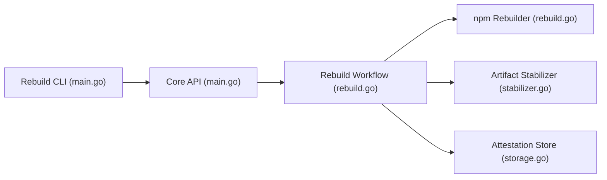

# google/oss-rebuild

> Rebuilds npm, PyPI and Crates.io packages and publishes build attestations, to secure the supply chain.

## The problem
A published package can differ from its source code without anyone noticing, as in the Solarwinds or Codecov compromises.

## What it actually does
Analyzes published metadata and artifacts, redoes the build, compares it with the upstream version and publishes a signed attestation if they match. The `oss-rebuild` CLI queries the data (`get`, `list`) and can output the Dockerfile. Only the most popular packages are rebuilt. The graph adds Debian, Maven and an AI-assisted agent.

## How it is wired


## Trying it
```bash
go install github.com/google/oss-rebuild/cmd/oss-rebuild@latest
oss-rebuild get pypi absl-py 2.0.0
oss-rebuild get pypi absl-py 2.0.0 --output=payload
oss-rebuild list pypi absl-py
gcloud auth application-default login
```

## Cost and gotchas
Google Cloud ADC credentials are required to verify signatures (public KMS key), unless `--verify=false` is used. Partial package coverage.

## What it is not
Not an officially supported Google product, according to the README. Does not guarantee that a package is flaw-free, only that it matches its rebuild.

## Alternatives
reproducible-central (Java, Kotlin), kpcyrd/rebuilderd (multi-distribution scheduler).

## For you
Worth watching: useful for verifying the PyPI dependencies of your ML pipelines, but coverage is limited to popular packages.
