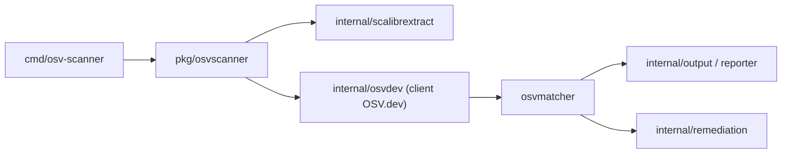

# google/osv-scanner

> A command-line scanner that links a project's dependencies to the known vulnerabilities in OSV.dev.

## The problem
Knowing which dependencies, container images or system packages of a project are affected by a published flaw.

## What it actually does
A Go binary analyzes a directory (`package.json`, `go.mod`, `pom.xml`...) or a container image, then queries the OSV.dev API. It can run a call analysis to limit false positives, work offline with a local database, and propose updates (`fix`, experimental) for npm and Maven. It is built on the OSV-Scalibr library.

## How it is wired


## Trying it
```bash
go install github.com/google/osv-scanner/v2/cmd/osv-scanner@latest
osv-scanner scan source -r /path/to/your/dir
osv-scanner scan image my-image-name:tag
osv-scanner --offline --download-offline-databases ./path/to/your/dir
```

## Cost and gotchas
Free. In connected mode, names, versions, ecosystems and file fingerprints are sent to OSV.dev and deps.dev; `--offline` avoids this. The `fix` command can run package manager scripts: do not run it on an untrusted project.

## What it is not
Not a source code analyzer: it only finds flaws that are already published. Remediation only covers `package-lock.json`, `package.json` and `pom.xml`.

## Alternatives
No alternative named in the README.

## For you
Adopt: a free, scriptable dependency check suits Docker images and the `requirements` of ML projects, with an offline mode for closed environments.
