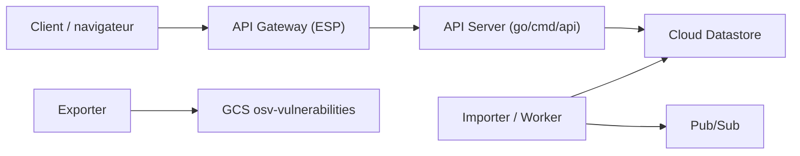

# google/osv.dev

> Open database of software vulnerabilities, with an API, a web interface and data exports.

## The problem
Knowing whether a project's dependencies have known flaws, with identifiers and versions that are comparable across ecosystems.

## What it actually does
This repository contains the code that runs osv.dev on GCP: API (Go), website, importer, exporter, version indexer, Python workers (oss_fuzz, vanir), feed converters (NVD, Alpine, Debian), Terraform and Cloud Deploy. You consume the service through the API, the interface or the dump (`gs://osv-vulnerabilities`). The dependency scanner lives in another repository. Third-party tools use it: Trivy, pip-audit, Renovate, Dependency-Track.

## How it is wired


## Trying it
```bash
git submodule update --init --recursive
```
For everyday use, the README points to the API documentation and the GCS dump, with no command in the README.

## Cost and gotchas
Free on the consumer side. Self-hosting the service is heavy (GCP, Datastore, Pub/Sub). Third-party tools are neither supported nor endorsed by the maintainers.

## What it is not
Not a scanner: it provides the data; the scanner is a separate repository.

## Alternatives
The README cites Trivy, pip-audit, Dependency-Track and Renovate as tools that build on OSV.

## For you
Adopt as a data source: plug the API or the dump into the dependency checking of a MLOps pipeline's Python/Docker dependencies; do not host this repository yourself.
