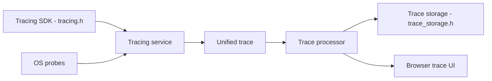

# google/perfetto

> Tracing and trace-analysis suite (SDK, daemons, UI, SQL) for system and performance developers.

## The problem
Understanding slowdowns and crashes in complex systems requires unified, usable traces.

## What it actually does
Tracing daemons and a C++17 SDK capture events and OS probes (scheduling, memory, profiles) into a trace file; a local web interface reads traces of several gigabytes; a SQL library (trace processor) queries traces, including those from Linux perf, Instruments or Chrome JSON. Default tracing system of Android and Chromium.

## How it is wired


## Trying it
The README gives no command: it points to the "Getting Started" documentation.

```bash
# non documenté dans le README
```

## Cost and gotchas
Free. Some OS probes target Android and Linux.

## What it is not
Not a continuous production monitoring tool; the sheet relies on a partially verified diagram.

## Alternatives
No alternative named in the README (replaces Chrome tracing).

## For you
Adopt to profile inference workloads or C++/Linux services in detail, with SQL queries on traces.
