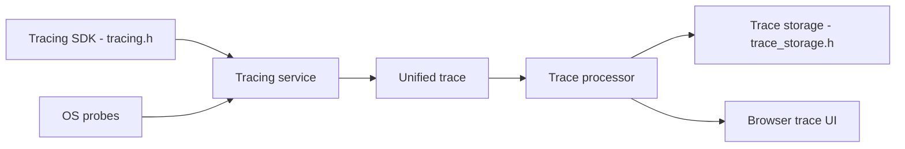

# google/perfetto

> Suite de traçage et d'analyse de traces (SDK, démons, UI, SQL) pour développeurs système et performance.

## Le problème
Comprendre les lenteurs et plantages de systèmes complexes demande des traces unifiées et exploitables.

## Ce que ça fait vraiment
Démons de traçage et SDK C++17 capturent événements et sondes OS (ordonnancement, mémoire, profils) dans un fichier de trace ; une interface web locale lit des traces de plusieurs gigaoctets ; une bibliothèque SQL (trace processor) interroge les traces, y compris celles de Linux perf, Instruments ou Chrome JSON. Système de traçage par défaut d'Android et de Chromium.

## Comment c'est branché


## Essayer
Le README ne donne aucune commande : renvoie à la documentation « Getting Started ».

```bash
# non documenté dans le README
```

## Coût et pièges
Gratuit. Certaines sondes OS ciblent Android et Linux.

## Ce que ce n'est pas
Pas un outil de monitoring en production continu ; la fiche s'appuie sur un schéma partiellement vérifié.

## Alternatives
Aucune alternative nommée dans le README (Chrome tracing remplacé).

## Pour toi
À adopter pour profiler finement des charges d'inférence ou des services C++/Linux avec requêtes SQL sur les traces.

