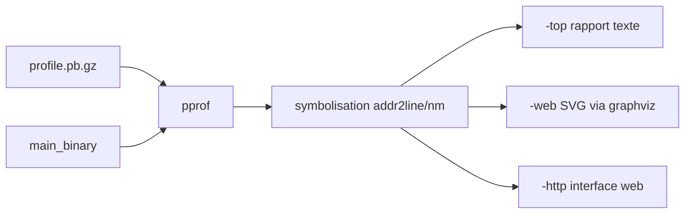

# google/pprof

> Viewer and analyzer of runtime profiles in profile.proto format, text or graphical.

## The problem
A raw profile of sampled callstacks is unreadable: without aggregation or symbolization, it is impossible to know where the time goes.

## What it actually does
Reads samples in profile.proto format from a local file or an HTTP URL.
Generates text reports sorted by "hotness", SVG graphs, or an interactive web interface.
Aggregates or compares several profiles of the same type.
Symbolizes machine addresses via addr2line and nm when binaries are provided.

## How it is wired


## Trying it
```bash
go install github.com/google/pprof@latest
pprof -top [main_binary] profile.pb.gz
pprof -web [main_binary] profile.pb.gz
pprof -http=[host]:[port] [main_binary] profile.pb.gz
```

## Cost and gotchas
Free. You need a Go development kit to install it; Graphviz is optional but required for graphical visualizations. On Windows, disassembly requires a binary built with `go build -buildmode=exe` and LLVM or GCC installed.

## What it is not
Not a profiler: it reads profiles produced elsewhere, it does not collect them. Not an official Google product, the README says so explicitly. Linux perf `perf.data` files need the `perf_to_profile` converter from another package.

## Alternatives
No named alternative; the README cites `perf_data_converter` as a complement, not as a competitor.

## For you
The de facto standard for profiling Go, and readable for any profile converted to profile.proto.
