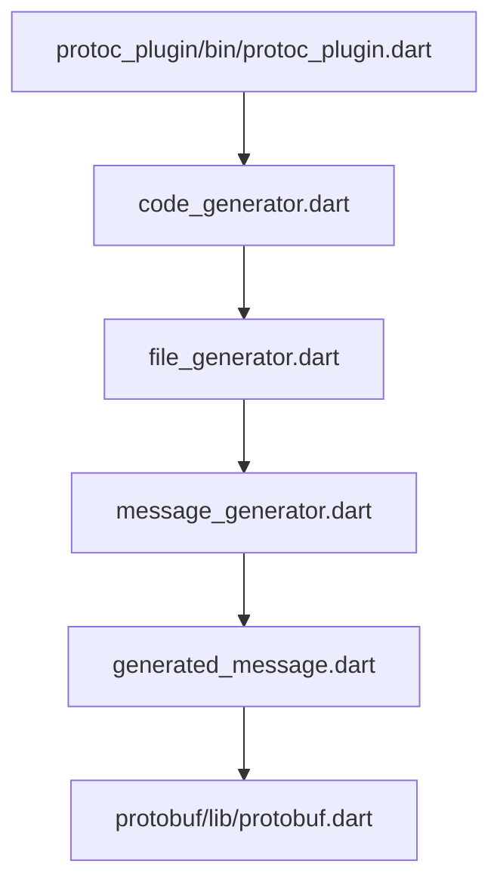

# google/protobuf.dart

> protoc plugin and Dart runtime to generate and read Protocol Buffers messages.

## The problem
Exchanging Protocol Buffers messages from Dart requires generated code and a serialization runtime.

## What it actually does
The README only talks about automating releases. From the code: protoc_plugin reads the descriptors and generates Dart; this code extends the protobuf runtime package, which handles binary and JSON. A benchmarks folder measures these operations.

## How it is wired


## Trying it
```bash
# Aucune commande documentée dans le README.
```

## Cost and gotchas
Free, BSD-3-Clause. Requires protoc and Dart; installation not documented here.

## What it is not
Not a general-purpose tool: it only concerns the Dart ecosystem.

## Alternatives
None named in the README.

## For you
Keep an eye on it: relevant only if a Dart or Flutter client talks gRPC or Protobuf with your services.
