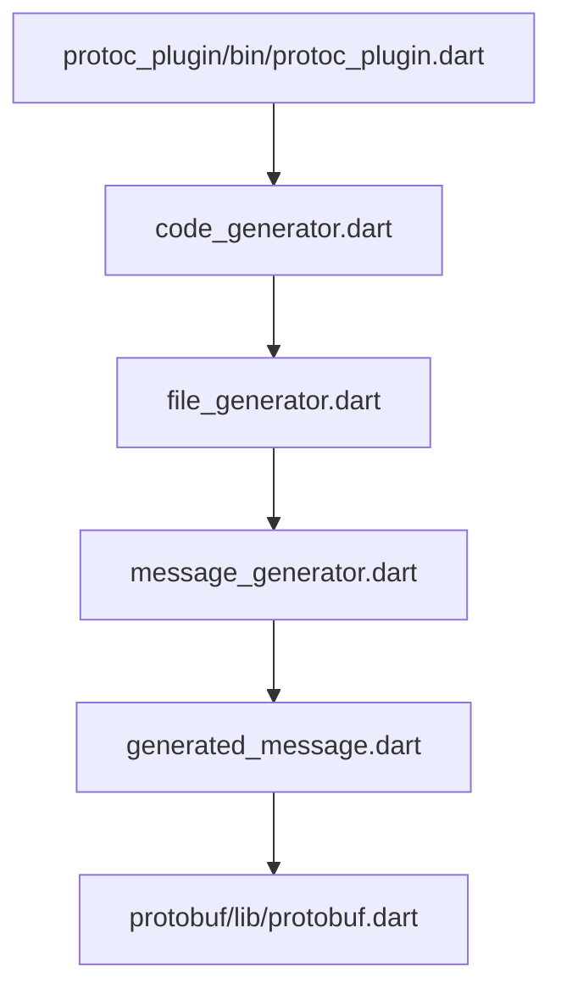

# google/protobuf.dart

> Plugin protoc et runtime Dart pour générer et lire des messages Protocol Buffers.

## Le problème
Échanger des messages Protocol Buffers depuis Dart demande du code généré et un runtime de sérialisation.

## Ce que ça fait vraiment
Le README ne parle que de l'automatisation des publications. D'après le code : protoc_plugin lit les descripteurs et génère du Dart ; ce code étend le paquet runtime protobuf, qui gère le binaire et le JSON. Un dossier benchmarks mesure ces opérations.

## Comment c'est branché


## Essayer
```bash
# Aucune commande documentée dans le README.
```

## Coût et pièges
Gratuit, BSD-3-Clause. Nécessite protoc et Dart ; installation non documentée ici.

## Ce que ce n'est pas
Pas un outil généraliste : il ne concerne que l'écosystème Dart.

## Alternatives
Aucune nommée dans le README.

## Pour toi
À surveiller : pertinent seulement si un client Dart ou Flutter parle gRPC ou Protobuf avec tes services.

