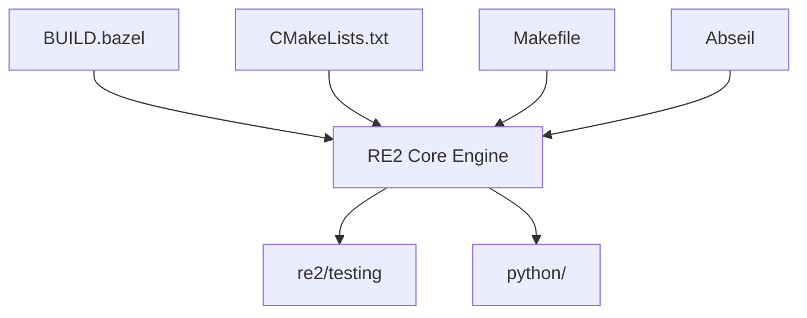

# google/re2

> C++ linear-time regular expression library, safe against patterns coming from untrusted users.

## The problem
Backtracking engines can blow up in time on certain patterns, which exposes a service to denial-of-service attacks.

## What it actually does
Evaluates regular expressions in time proportional to the size of the text, with bounded memory and no recursion. It rejects backreferences and lookaround assertions. It offers FullMatch, PartialMatch, subgroup extraction and an official Python wrapper (google-re2).

## How it is wired



## Trying it
```bash
make
make test
make install
pip install google-re2
```
The Python command comes from the README (PyPI name `google-re2`).

## Cost and gotchas
Free, BSD-3-Clause license. You need a C++17 compiler and Abseil; the tests require GoogleTest and Benchmark. The repository does not accept GitHub pull requests.

## What it is not
Not always faster than other engines: safety takes precedence over speed. It does not normalize Unicode (composed and decomposed ü differ).

## Alternatives
- RE2J: pure Java port, cited in the README.
- Rust's regex crate and Go's regexp: same principles, no shared code.

## For you
Watch: use it via google-re2 when your pipeline applies patterns provided by users; Python's `re` module remains sufficient otherwise.
