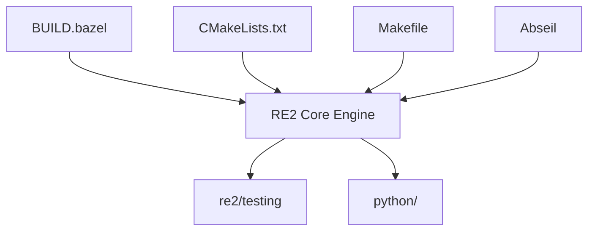

# google/re2

> Bibliothèque C++ d'expressions régulières à temps linéaire, sûre face à des motifs venant d'utilisateurs non fiables.

## Le problème
Les moteurs à retour arrière peuvent exploser en temps sur certains motifs, ce qui expose un service à des attaques par déni de service.

## Ce que ça fait vraiment
Évalue les expressions régulières avec un temps proportionnel à la taille du texte, une mémoire bornée et sans récursion. Elle refuse les références arrière et les assertions de regard. Elle offre FullMatch, PartialMatch, l'extraction de sous-groupes et un wrapper Python officiel (google-re2).

## Comment c'est branché



## Essayer
```bash
make
make test
make install
pip install google-re2
```
La seconde commande de Python vient du README (nom PyPI `google-re2`).

## Coût et pièges
Gratuit, licence BSD-3-Clause. Il faut un compilateur C++17 et Abseil ; les tests demandent GoogleTest et Benchmark. Le dépôt n'accepte pas les pull requests GitHub.

## Ce que ce n'est pas
Pas toujours plus rapide que les autres moteurs : la sécurité prime sur la vitesse. Il ne normalise pas l'Unicode (ü composé et décomposé diffèrent).

## Alternatives
- RE2J : portage en Java pur, cité dans le README.
- Le paquet regex de Rust et regexp de Go : mêmes principes, sans partage de code.

## Pour toi
À surveiller : à utiliser via google-re2 quand ton pipeline applique des motifs fournis par des utilisateurs ; le module re de Python reste suffisant sinon.

