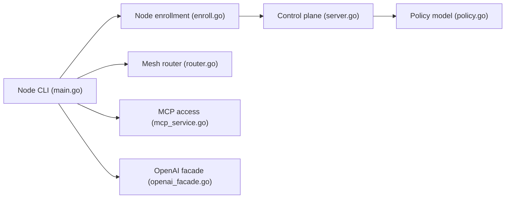

# google/sam

> Private network for AI agents: publishing of tools and models, discovery and verifiable identity.

## The problem
Distributed agents (laptops, containers, clusters, behind NAT) cannot easily find each other or authenticate with one another.

## What it actually does
A `sam-node` runs next to the agent, publishes its local services, discovers those of others and exposes a local MCP server plus an OpenAI-compatible API. A control plane validates identity (OIDC or token) and issues short-lived credentials; a router relays traffic when the direct connection fails. Nothing is reachable by default.

## How it is wired


## Trying it
```bash
curl -sL https://sam-mesh.dev/install.sh | bash
sam-node join https://bananas.sam-mesh.dev
sam-node run --daemonize
sam-node skill install
```

## Cost and gotchas
Free. The shared trial network has no availability guarantee. Pre-1.0; sandboxed agents and the mobile app are in preview. Piping a remote script into bash calls for caution.

## What it is not
Not an agent framework: it connects existing agents. The README gives no performance details.

## Alternatives
No alternative named in the README.

## For you
Worth watching: a solid idea for connecting agents with explicit permissions, but pre-1.0; test on your own mesh before any real use.
