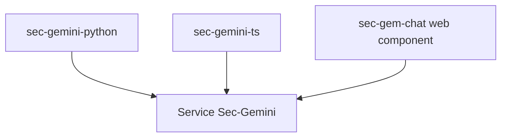

# google/sec-gemini

> Python and TypeScript SDK for Sec-Gemini, Google's experimental AI dedicated to cybersecurity.

## The problem
Calling a security-specialized AI service from your code or website requires a dedicated client.

## What it actually does
Two SDKs, `sec-gemini-python/` and `sec-gemini-ts/`, and a `<sec-gem-chat>` web component to embed in a page with an API key. The README describes nothing else.

## How it is wired
Simplified diagram based on the sheet, no diagram provided.



## Trying it
```html
<sec-gem-chat incognito="true" session-name="TestName" theme="dark" api-key="...">
</sec-gem-chat>
<script src='https://cdn.jsdelivr.net/npm/sec-gemini-web-component/dist/swc.iife.js'>
```

## Cost and gotchas
Depends on Google's hosted service, with an API key. Access terms and pricing: not documented. The project is not an officially supported product.

## What it is not
Not a model or a local tool: only clients for a remote service. Excluded from Google's vulnerability reward program.

## Alternatives
None cited in the README.

## For you
Ignore: nearly empty README, closed experimental service, nothing to evaluate without access.
