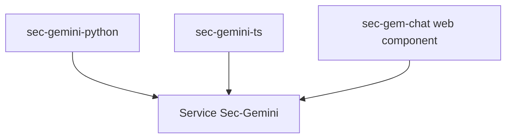

# google/sec-gemini

> SDK Python et TypeScript pour Sec-Gemini, l'IA expérimentale de Google dédiée à la cybersécurité.

## Le problème
Appeler un service d'IA spécialisé en sécurité depuis son code ou son site demande un client dédié.

## Ce que ça fait vraiment
Deux SDK, `sec-gemini-python/` et `sec-gemini-ts/`, et un composant web `<sec-gem-chat>` à intégrer dans une page avec une clé d'API. Le README ne décrit rien d'autre.

## Comment c'est branché
Schéma simplifié d'après la fiche, sans diagramme fourni.



## Essayer
```html
<sec-gem-chat incognito="true" session-name="TestName" theme="dark" api-key="...">
</sec-gem-chat>
<script src='https://cdn.jsdelivr.net/npm/sec-gemini-web-component/dist/swc.iife.js'>
```

## Coût et pièges
Dépend du service hébergé de Google, avec une clé d'API. Modalités d'accès et tarifs : non documentés. Le projet n'est pas un produit officiellement supporté.

## Ce que ce n'est pas
Pas un modèle ni un outil local : seulement des clients d'un service distant. Exclu du programme de récompenses de vulnérabilités de Google.

## Alternatives
Aucune citée dans le README.

## Pour toi
Ignorer : README presque vide, service expérimental fermé, rien à évaluer sans accès.

