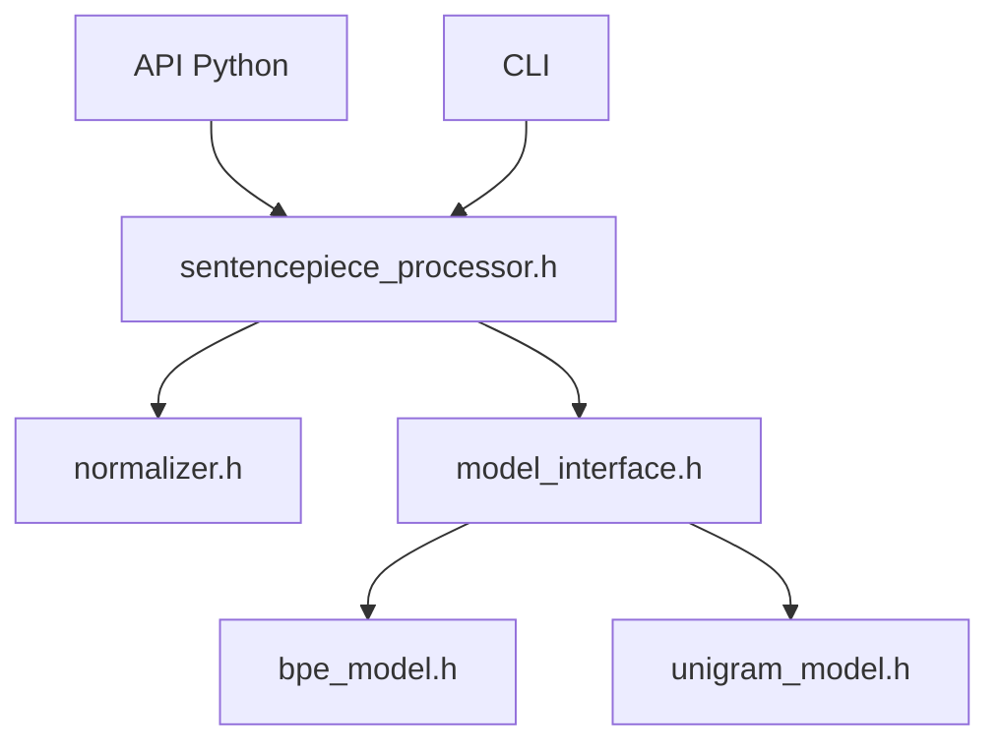

# google/sentencepiece

> Unsupervised, fast, and reversible subword tokenizer for training and serving language models.

## The problem
Language-dependent tokenizers lose whitespace and make detokenization ambiguous.

## What it actually does
It trains a BPE or Unigram model directly on raw text with a fixed vocabulary size. The space becomes the `▁` symbol, hence lossless detokenization. It offers subword sampling (regularization, BPE-dropout). The `.model` file contains normalization and vocabulary. A dependency-free C++20 "Lite" variant exists.

## How it is wired


## Trying it
```bash
pip install sentencepiece
```
```python
import sentencepiece as spm
spm.SentencePieceTrainer.train(input='data/botchan.txt', model_prefix='m', vocab_size=1000)
sp = spm.SentencePieceProcessor(model_file='m.model')
ids = sp.encode("I saw a girl with a telescope.", return_type=int)
```

## Cost and gotchas
Free, no service dependency. The README states that it is not an official Google product.

## What it is not
Not a model-training framework. Speed comparisons come from the README, not from independent verification.

## Alternatives
Hugging Face fast tokenizers: compared in the README; slower in the measurements provided.

## For you
Adopt: a standard building block of the LLM tokenization chain, stable, installable with one command.
