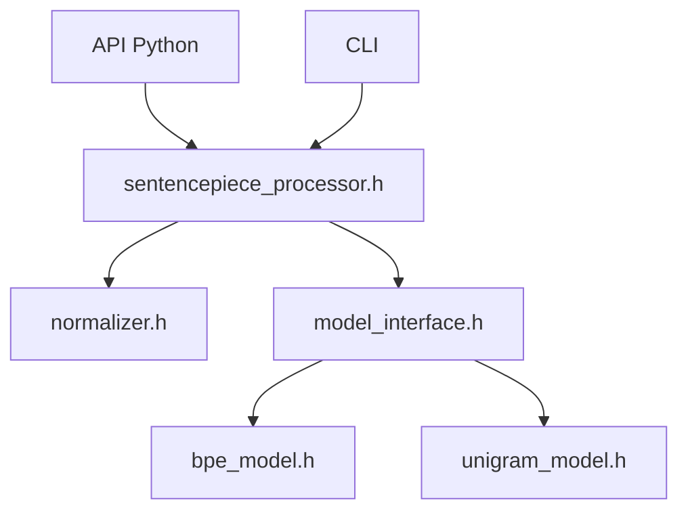

# google/sentencepiece

> Tokeniseur de sous-mots non supervisé, rapide et réversible, pour entraîner et servir des modèles de langage.

## Le problème
Les tokeniseurs dépendants de la langue perdent les espaces et rendent la détokenisation ambiguë.

## Ce que ça fait vraiment
Il entraîne directement sur du texte brut un modèle BPE ou Unigram avec taille de vocabulaire fixée. L'espace devient le symbole `▁`, d'où une détokenisation sans perte. Il propose l'échantillonnage de sous-mots (régularisation, BPE-dropout). Le fichier `.model` contient normalisation et vocabulaire. Une variante « Lite » en C++20 sans dépendances existe.

## Comment c'est branché


## Essayer
```bash
pip install sentencepiece
```
```python
import sentencepiece as spm
spm.SentencePieceTrainer.train(input='data/botchan.txt', model_prefix='m', vocab_size=1000)
sp = spm.SentencePieceProcessor(model_file='m.model')
ids = sp.encode("I saw a girl with a telescope.", return_type=int)
```

## Coût et pièges
Gratuit, aucune dépendance de service. Le README précise qu'il ne s'agit pas d'un produit Google officiel.

## Ce que ce n'est pas
Pas un framework d'entraînement de modèles. Les comparaisons de vitesse viennent du README, pas d'une vérification indépendante.

## Alternatives
Tokeniseurs rapides de Hugging Face : comparés dans le README ; plus lents dans les mesures fournies.

## Pour toi
À adopter : brique standard de la chaîne de tokenisation des LLM, stable, installable en une commande.

