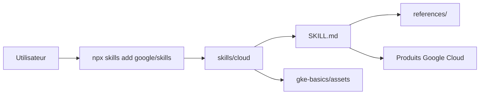

# google/skills

> Catalog of agent skills, published by Google, for working with Google Cloud, Firebase, Ads and Gemini.

## The problem
A coding agent doesn't know the up-to-date best practices of each Google Cloud product. It improvises approximate gcloud commands, GKE manifests or BigQuery queries.

## What it actually does
The repository contains no program: it is `skills/cloud/<name>/` folders with a `SKILL.md` and `references/` sub-documents. Each skill can be installed individually. The catalog covers GKE, BigQuery, AlloyDB, Cloud Run, Gemini API, security/IAM, SecOps, Ads and the Well-Architected Framework. Only `gke-basics` ships example YAML manifests.

## How it is wired


## Trying it
```bash
npx skills add google/skills
claude plugin marketplace add google/skills
claude plugin install @google-plugins
```

## Cost and gotchas
The skills are free, but what they trigger (GKE, BigQuery, Gemini) is billed to your Google Cloud account. The catalog is very broad: install only what you use.

## What it is not
It is not a library or a server: no execution, only instructions for the agent. Nor is it vendor-neutral: everything is centered on Google products.

## Alternatives
The README cites none; it only mentions complementary lists (ADK, Android, Flutter, Maps, Firestore skills).

## For you
Worth watching: useful if you work on BigQuery, Vertex/Agent Platform or GKE with a coding agent, of no interest if your stack is not on Google Cloud.
