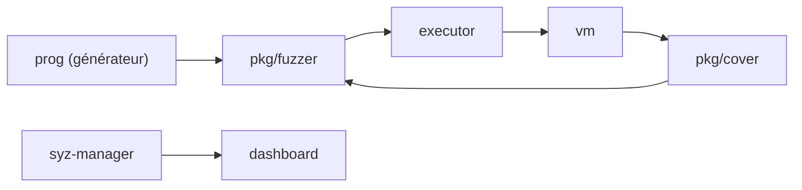

# google/syzkaller

> Coverage-guided OS kernel fuzzer, for kernel researchers and maintainers.

## The problem
Kernel bugs (Linux, BSD, Windows…) are hard to find by hand.

## What it actually does
Generates programs of system calls (`prog`, descriptions in `sys`), runs them in virtual machines via an executor, collects coverage and crashes, and feeds the results back into generation. Modules: syz-manager, syz-hub, dashboard, syz-cluster, coverage databases. The README refers to the documentation for installation and usage.

## How it is wired

## Trying it
No command documented in the README: see the linked installation documentation.

## Cost and gotchas
Free, but heavy: VMs, an instrumented kernel, compute time. Documentation mostly focused on Linux. 639 open issues.

## What it is not
Not an application security scanner; "not an official Google product".

## Alternatives
None named in the README.

## For you
Ignore: kernel fuzzing, outside the data/AI/MLOps scope.
