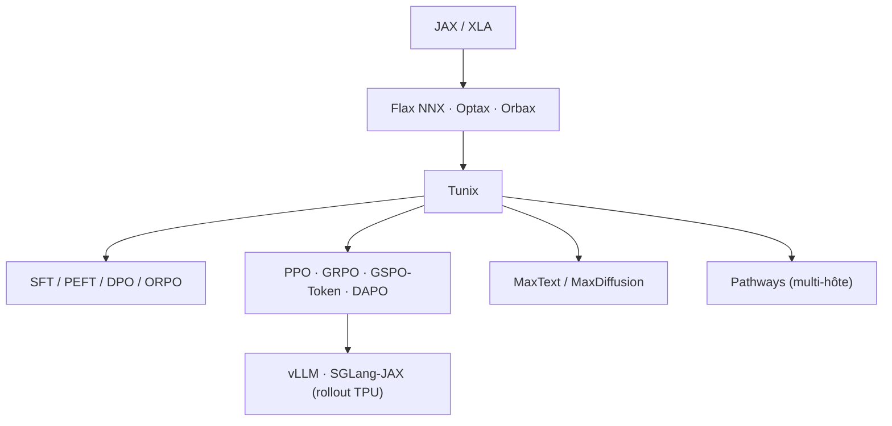

# google/tunix

> JAX library for LLM post-training, built for TPUs.

## The problem
Post-training an LLM in JAX means stitching together SFT, RL, inference rollout and multi-host
checkpointing yourself.

## What it actually does
Covers supervised fine-tuning (full weights, PEFT, DPO, ORPO), reinforcement learning (PPO,
GRPO, GSPO-Token, DAPO, Dr.GRPO) and agentic RL (multi-turn tool use, asynchronous rollout for
trajectory collection, batching). Builds on Flax NNX, Optax, Orbax, integrates natively with
vLLM and SGLang-JAX for rollout on TPU and with MaxText for high-performance kernels.
Multi-host distributed training via Pathways is claimed to scale to thousands of accelerators,
with checkpointing and fault tolerance. Displayed status: "V2 Release", active development.

## How it is wired


## Trying it
```bash
# Deux chemins d'installation TPU documentés, exclusifs l'un de l'autre :
# 1) image Docker construite depuis Dockerfile (requirements/requirements.txt
#    et requirements/special_requirements.txt épinglés)
# 2) scripts/install_tunix_vllm_requirement.sh sur VM TPU ou machine de dev
```
The README gives no other command: it points to the Installation page and the notebooks.

## Cost and gotchas
Free, but TPU-oriented: the announced gains are on TPU, and the vLLM/`tpu-inference`
integration has its own pinned dependencies. If you build the Docker image, do not also run the
install script inside the container.

## What it is not
Not a pre-training framework nor a model library: it is the intermediate layer between JAX
utilities and optimized models such as MaxText. Nor is it PyTorch: the whole ecosystem is JAX.

## Alternatives
- GRL (Hao AI Lab, UCSD): multi-turn RL framework on games, a partner rather than a
  competitor, integrated with Tunix for TPU support.

## For you
Interesting only if you have access to TPUs and your stack is already JAX.
