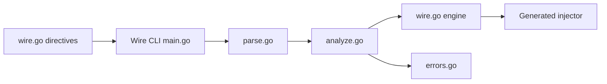

# google/wire

> Go code generator that wires dependencies at compile time, without reflection.

## The problem
Initializing a graph of Go components by hand is repetitive; runtime injection containers use reflection and global state.

## What it actually does
The developer declares providers (functions) and an injector template using the `wire` directives. The `wire` command analyzes the packages, builds the provider graph, and generates the Go initialization code. Dependencies are plain function parameters.

## How it is wired


## Trying it
```bash
go install github.com/google/wire/cmd/wire@latest
```

## Cost and gotchas
Archived repository, no longer maintained (README warning); any evolution has to go through a fork. The project declared itself beta and feature-complete as of v0.3.0.

## What it is not
Not a runtime injection container.

## Alternatives
No alternative named in the README.

## For you
Archived and unrelated to data/AI: do not start on it; pick a maintained project if you do Go.
