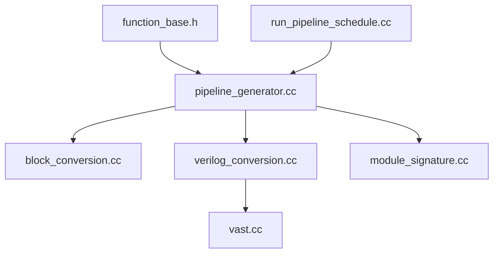

# google/xls

> High-level synthesis toolchain that generates Verilog from a Rust-like language.

## The problem
Designing hardware requires low-level languages; software and hardware share tooling poorly.

## What it actually does
A DSLX language produces an IR representation, optimized and scheduled into a pipeline, before Verilog/SystemVerilog generation. The same design runs in software (interpreter, LLVM JIT) or in hardware. Includes a fuzzer, Z3 provers and Yosys/OpenROAD flows in the notebooks.

## How it is wired


## Trying it
```bash
bazel test -c opt -- //xls/... -//xls/contrib/xlscc/...
./interpreter_main --version
```

## Cost and gotchas
Bazel build: about 2 h without the C++ front-end, up to 6 h with it, on 8 cores. DSLX evolves without backward compatibility.

## What it is not
Not a supported Google product, not an AI tool: the README says it is experimental.

## Alternatives
No alternative named in the README.

## For you
Ignore: hardware synthesis, useful only if you design accelerators.
