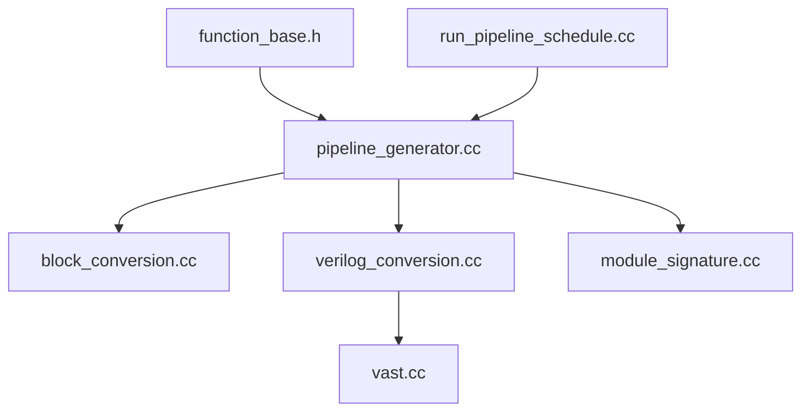

# google/xls

> Chaîne de synthèse haut niveau qui génère du Verilog depuis un langage proche de Rust.

## Le problème
Concevoir du matériel exige des langages bas niveau ; logiciel et matériel partagent mal leurs outils.

## Ce que ça fait vraiment
Un langage DSLX produit une représentation IR, optimisée puis ordonnancée en pipeline, avant génération de Verilog/SystemVerilog. Le même design tourne en logiciel (interpréteur, JIT LLVM) ou en matériel. Inclut fuzzer, prouveurs Z3 et flux Yosys/OpenROAD dans les notebooks.

## Comment c'est branché


## Essayer
```bash
bazel test -c opt -- //xls/... -//xls/contrib/xlscc/...
./interpreter_main --version
```

## Coût et pièges
Build Bazel : environ 2 h sans le front-end C++, jusqu'à 6 h avec, sur 8 coeurs. DSLX évolue sans compatibilité ascendante.

## Ce que ce n'est pas
Pas un produit Google supporté, pas un outil d'IA : le README le dit expérimental.

## Alternatives
Aucune alternative nommée dans le README.

## Pour toi
Ignorer : synthèse matérielle, utile seulement si tu conçois des accélérateurs.

