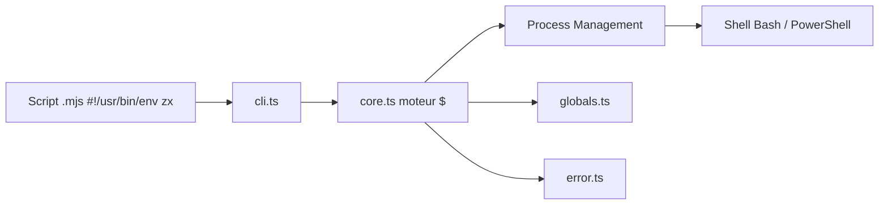

# google/zx

> JavaScript wrapper for writing more readable shell scripts, with escaped arguments, for Node developers.

## The problem
Bash becomes painful as soon as the script grows, and Node's standard library requires plumbing code around `child_process`.

## What it actually does
`zx` provides the `$` tag: a command written as a template string runs and returns a promise. Interpolated variables are escaped automatically. Promises allow running several commands in parallel. It runs on Node, Bun, Deno and GraalVM, on Linux, macOS or Windows (Bash or PowerShell), in JS or TS, CJS or ESM.

## How it is wired


## Trying it
```bash
npm install zx
```
```js
#!/usr/bin/env zx
await $`cat package.json | grep name`
```

## Cost and gotchas
Free; Node ≥ 12.17.0 for the full version (a `zx@lite` variant exists). A script really executes system commands: review it before running.

## What it is not
Not a task orchestrator nor a Make replacement. It does not make a script portable if the commands it calls are not.

## Alternatives
- zx@lite: lighter version cited in the README.

## For you
Worth watching: useful if your tooling scripts are already in JS, but a Python profile covers the same need without adding Node.
