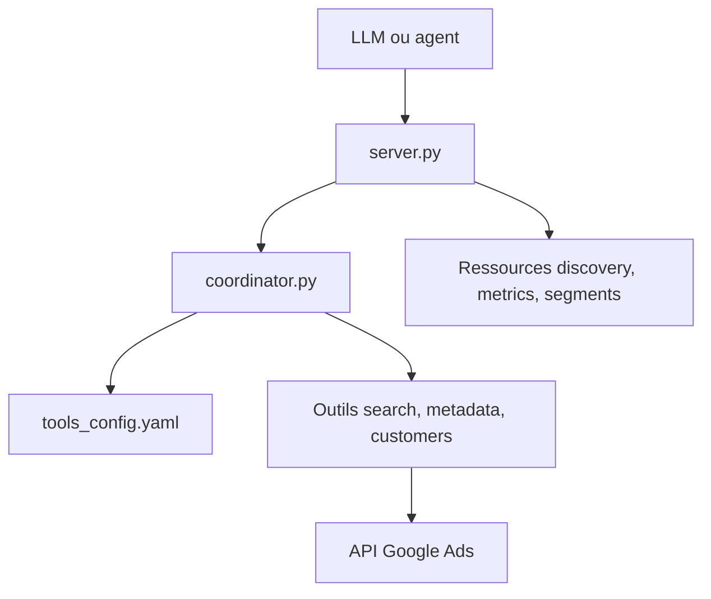

# googleads/google-ads-mcp

> MCP server that lets an AI agent query and modify a Google Ads account, for marketing data teams.

## The problem
Querying Google Ads requires knowing GAQL and its API, which blocks conversational access to campaign data.

## What it actually does
- `search` tools (GAQL queries), `get_resource_metadata` and `list_accessible_customers`.
- Write tools: create assets, upload a video, manage labels and associations.
- Two-step "Propose & Confirm" writes: a simulation with a checksum, then confirmation.
- Reference resources: discovery document, metrics, segments, release notes; optional FastMCP OAuth.

## How it is wired


## Trying it
```bash
pipx run --spec "google-ads-mcp==X.Y.Z" google-ads-mcp
gcloud auth application-default login --scopes https://www.googleapis.com/auth/adwords,https://www.googleapis.com/auth/cloud-platform --client-id-file=YOUR_CLIENT_JSON_FILE
```

## Cost and gotchas
A Google Cloud project, the Google Ads API enabled and OAuth credentials are required. Account data is exposed to the LLM, and a usage-collection header is added to calls.

## What it is not
Not an analysis tool: it relays queries. Writes are enabled by default; set `labels` and `assets` to `false` for read-only.

## Alternatives
No alternative named in the README.

## For you
Worth watching: a clean example of an MCP with write confirmation, useful if you work on advertising data.
