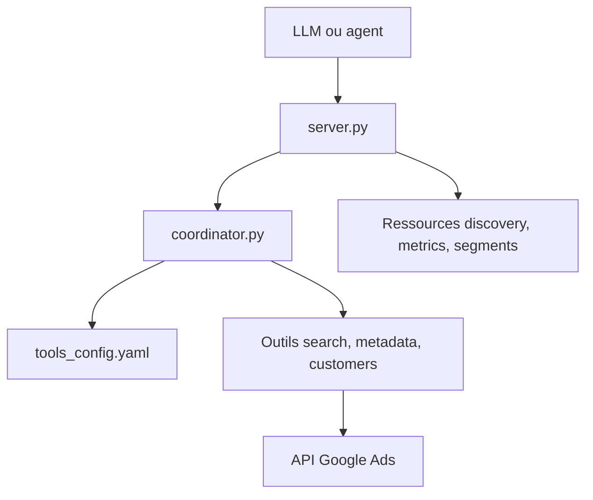

# googleads/google-ads-mcp

> Serveur MCP qui laisse un agent IA interroger et modifier un compte Google Ads, pour équipes marketing data.

## Le problème
Interroger Google Ads demande de connaître GAQL et son API, ce qui bloque l'accès conversationnel aux données de campagnes.

## Ce que ça fait vraiment
- Outils `search` (requêtes GAQL), `get_resource_metadata` et `list_accessible_customers`.
- Outils d'écriture : créer des assets, téléverser une vidéo, gérer étiquettes et associations.
- Écritures en deux temps « Propose & Confirm » : simulation avec somme de contrôle, puis confirmation.
- Ressources de référence : discovery document, métriques, segments, notes de version ; OAuth FastMCP optionnel.

## Comment c'est branché


## Essayer
```bash
pipx run --spec "google-ads-mcp==X.Y.Z" google-ads-mcp
gcloud auth application-default login --scopes https://www.googleapis.com/auth/adwords,https://www.googleapis.com/auth/cloud-platform --client-id-file=YOUR_CLIENT_JSON_FILE
```

## Coût et pièges
Projet Google Cloud, API Google Ads activée et identifiants OAuth requis. Les données du compte sont exposées au LLM, et un en-tête de collecte d'usage est ajouté aux appels.

## Ce que ce n'est pas
Pas un outil d'analyse : il relaie des requêtes. Les écritures sont activées par défaut ; mettre `labels` et `assets` à `false` pour du lecture seule.

## Alternatives
Aucune alternative nommée dans le README.

## Pour toi
À surveiller : exemple propre de MCP avec confirmation des écritures, utile si tu travailles sur des données publicitaires.

