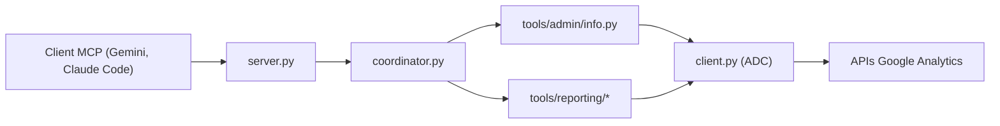

# googleanalytics/google-analytics-mcp

> Local, read-only MCP server that lets an LLM query Google Analytics.

## The problem
Asking questions about your GA properties (events, dimensions, reports) without going through the interface or writing API code.

## What it actually does
Python server launched via `pipx run analytics-mcp`. Exposes: account summaries, property details, Google Ads links, `run_report`, `run_funnel_report`, `run_realtime_report`, custom dimensions/metrics. Uses the Admin and Data APIs with Application Default Credentials at the `analytics.readonly` scope. No local persistence is visible.

## How it is wired


## Trying it
```bash
gcloud auth application-default login \
  --scopes https://www.googleapis.com/auth/analytics.readonly,https://www.googleapis.com/auth/cloud-platform \
  --client-id-file=YOUR_CLIENT_JSON_FILE
claude mcp add analytics-mcp \
  --scope user \
  -e "GOOGLE_APPLICATION_CREDENTIALS=PATH_TO_CREDENTIALS_JSON" \
  -e "GOOGLE_PROJECT_ID=YOUR_PROJECT_ID" \
  -- pipx run analytics-mcp
```

## Cost and gotchas
You need a Google Cloud project with both APIs enabled and OAuth credentials or a service account. The README title states "Experimental". The README documents Gemini first, Claude Code second.

## What it is not
Not a write or administration tool: read-only. Not a data warehouse: each question calls the API again.

## Alternatives
Not documented in the README.

## For you
Watch: useful only if you have a site instrumented with GA; the OAuth setup is the real cost.
