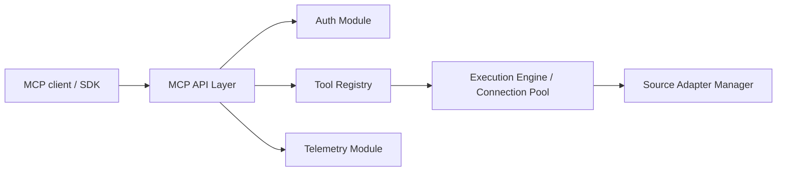

# googleapis/genai-toolbox

> Open source MCP server (MCP Toolbox for Databases) that gives agents tooled access to your databases.

## The problem
Connecting an agent to a database requires access code, pooling, authentication and traceability.

## What it actually does
Two uses: ready-made tools (`--prebuilt=postgres`: list_tables, execute_sql) and custom tools declared in `tools.yaml` (sources, parameterized queries, toolsets, prompts). Compatible with many databases (BigQuery, Postgres, MySQL, MongoDB, Snowflake…). Connection pool, IAM, OpenTelemetry, hot reload, Python, JS and Go SDKs. The repository has been renamed mcp-toolbox.

## How it is wired


## Trying it
```bash
npx @toolbox-sdk/server --config tools.yaml
./toolbox --config "tools.yaml"
./toolbox --ui
```

## Cost and gotchas
Free; database access remains at your expense and yours to secure (passwords in tools.yaml). The catalog says "license not declared" whereas the README shows an Apache 2.0 badge.

## What it is not
Not a SQL generator: custom tools are written by you. The prebuilt npx mode is convenient but less reliable than the binary.

## Alternatives
- Google Cloud MCP Servers: managed version mentioned in the README.

## For you
Adopt to give an agent controlled access to a database: predefined queries, authentication and origin traces.
