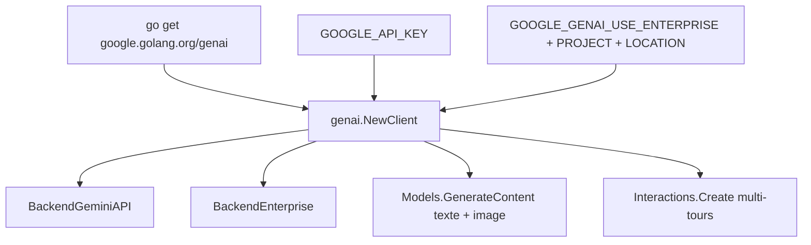

# googleapis/go-genai

> Official Go SDK for calling Gemini models, via the developer API or the enterprise platform.

## The problem
Two Gemini entry points coexist — the developer API and the enterprise platform — with different authentication methods.
Without an SDK, you have to write two call paths and maintain them separately.

## What it actually does
A single client, `genai.NewClient`, whose `Backend` field switches between `BackendGeminiAPI` and `BackendEnterprise`.
Configuration can be carried entirely by environment variables, the client then being built with an empty config.
`client.Models.GenerateContent` accepts parts mixing text and binary data, which covers multimodal in a few lines.
The Interactions API allows multi-turn conversations with models or agents, via `client.Interactions.Create`.

## How it is wired


## Trying it
```bash
go get google.golang.org/genai
export GOOGLE_API_KEY='your-api-key'
export GOOGLE_GENAI_USE_ENTERPRISE=true
export GOOGLE_CLOUD_PROJECT='your-project-id'
export GOOGLE_CLOUD_LOCATION='us-central1'
```

## Cost and gotchas
Gemini model consumption is billed to your account; enterprise mode requires a cloud project and a region.
`GenerateVideos` will lose its `prompt`, `text` and `image` arguments in favor of `source`: the README recommends pinning the version `< 2.0.0` to avoid the breakage.

## What it is not
Not an agent framework: the Interactions API handles multi-turn, not full tool orchestration.
Not local execution: everything goes through Google services.
Not frozen: an upcoming breaking-change warning appears right in the README header.

## Alternatives
No alternative named in the README.

## For you
Of no interest as long as you do not write Go and your stack is not on Gemini.
