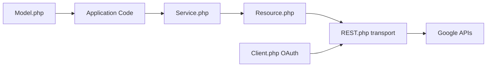

# googleapis/google-api-php-client

> Official PHP client for calling Google APIs (Gmail, Drive, YouTube...), in maintenance mode.

## The problem
Calling Google APIs in PHP requires OAuth, service accounts, REST calls, batching and uploads.

## What it actually does
A configured client (`Google\Client`) and generated service classes (separate package `google/apiclient-services`) map JSON requests to typed objects. Handles OAuth, service accounts, batches, uploads, retries, PSR-6 caching, and a Guzzle client.

## How it is wired


## Trying it
```bash
composer require google/apiclient
php -S localhost:8000 -t examples/
```

## Cost and gotchas
Google Cloud credentials (OAuth or service account) are required; each API's quotas apply. The 200 services are heavy: clean up via `Google\Task\Composer::cleanup`.

## What it is not
Not the recommended tool for Google Cloud: the README points to the dedicated cloud libraries. Maintenance only: no new features.

## Alternatives
The `googleapis/google-cloud-php` libraries for Cloud APIs, and `google/auth` for authentication alone.

## For you
Ignore: PHP client in maintenance, of no interest for a Python data/AI/MLOps profile.
