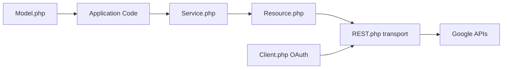

# googleapis/google-api-php-client

> Client PHP officiel pour appeler les API Google (Gmail, Drive, YouTube…), en mode maintenance.

## Le problème
Appeler des API Google en PHP exige OAuth, comptes de service, appels REST, lots et téléversements.

## Ce que ça fait vraiment
Un client configuré (`Google\Client`) et des classes de service générées (paquet séparé `google/apiclient-services`) mappent les requêtes JSON vers des objets typés. Gère OAuth, comptes de service, lots, téléversements, relances, cache PSR-6, client Guzzle.

## Comment c'est branché


## Essayer
```bash
composer require google/apiclient
php -S localhost:8000 -t examples/
```

## Coût et pièges
Il faut des identifiants Google Cloud (OAuth ou compte de service) ; les quotas de chaque API s'appliquent. Les 200 services pèsent : nettoyer via `Google\Task\Composer::cleanup`.

## Ce que ce n'est pas
Pas l'outil recommandé pour Google Cloud : le README renvoie aux bibliothèques cloud dédiées. Maintenance seulement : pas de nouvelles fonctions.

## Alternatives
Les bibliothèques `googleapis/google-cloud-php` pour les API Cloud, et `google/auth` pour la seule authentification.

## Pour toi
À ignorer : client PHP en maintenance, sans intérêt pour un profil data/IA/MLOps en Python.

