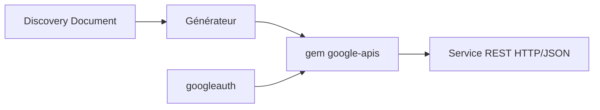

# googleapis/google-api-ruby-client

> Automatically generated Ruby REST clients for Google APIs, to use when no modern client exists.

## The problem
Calling a Google API from Ruby without writing the HTTP calls and data structures yourself.

## What it actually does
- One gem per API, named `google-apis-<service>_<version>`.
- Generated from Discovery Documents; the generator is in the repository.
- Authentication through googleauth (OAuth, API keys, service accounts), with retries, pagination and timeouts.
- The README recommends the modern client when one exists (google-cloud-ruby repository).

## How it is wired


## Trying it
```bash
gem install google-apis-drive_v3
```
```ruby
require 'google/apis/drive_v3'
drive = Google::Apis::DriveV3::DriveService.new
drive.authorization = ... # voir Googleauth ou Signet
files = drive.list_files(q: "title contains 'finances'")
```

## Cost and gotchas
Google account and credentials required. OpenCensus support is obsolete: migrate to OpenTelemetry.

## What it is not
Not the recommended client for BigQuery, Cloud Storage or Pub/Sub. Interfaces sometimes unnatural, no gRPC.

## Alternatives
Modern clients from the google-cloud-ruby repository: simpler, faster, with streaming and long-running operations.

## For you
Ignore: Ruby, and for BigQuery or Cloud Storage the README itself points to the modern clients.
