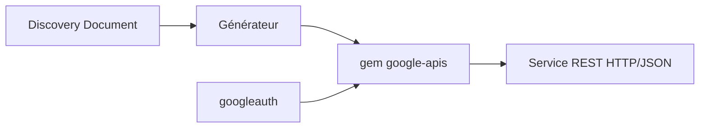

# googleapis/google-api-ruby-client

> Clients REST Ruby générés automatiquement pour les API Google, à utiliser quand aucun client moderne n'existe.

## Le problème
Appeler une API Google depuis Ruby sans écrire soi-même les appels HTTP et les structures de données.

## Ce que ça fait vraiment
- Un gem par API, nommé `google-apis-<service>_<version>`.
- Générés depuis les Discovery Documents ; le générateur est dans le dépôt.
- Authentification via googleauth (OAuth, clés d'API, comptes de service), avec retries, pagination et timeouts.
- Le README recommande le client moderne quand il existe (dépôt google-cloud-ruby).

## Comment c'est branché


## Essayer
```bash
gem install google-apis-drive_v3
```
```ruby
require 'google/apis/drive_v3'
drive = Google::Apis::DriveV3::DriveService.new
drive.authorization = ... # voir Googleauth ou Signet
files = drive.list_files(q: "title contains 'finances'")
```

## Coût et pièges
Compte Google et identifiants requis. Le support OpenCensus est obsolète : migrer vers OpenTelemetry.

## Ce que ce n'est pas
Pas le client recommandé pour BigQuery, Cloud Storage ou Pub/Sub. Interfaces parfois peu naturelles, sans gRPC.

## Alternatives
Clients modernes du dépôt google-cloud-ruby : plus simples, plus rapides, streaming et opérations longues.

## Pour toi
À ignorer : Ruby, et pour BigQuery ou Cloud Storage le README renvoie lui-même vers les clients modernes.

