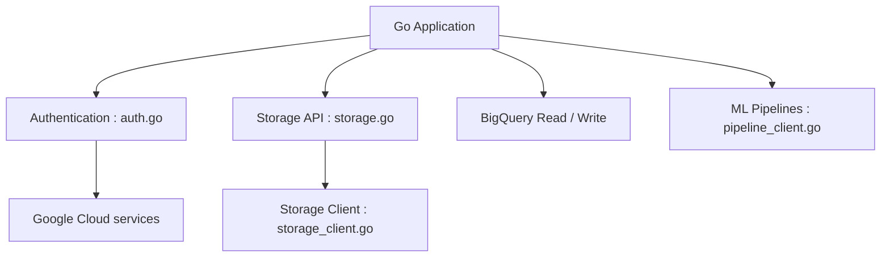

# googleapis/google-cloud-go

> Go client libraries for calling Google Cloud services, with automatic authentication.

## The problem
Calling Cloud Storage, BigQuery or other services from Go without writing the HTTP/gRPC calls by hand.

## What it actually does
A collection of Go packages, one per service. Each client uses Application Default Credentials by default, or a service account key file, or explicit credentials. The Storage package adds a higher-level object API. Some packages may change without backward compatibility.

## How it is wired


## Trying it
```bash
go get cloud.google.com/go/firestore@latest
gcloud auth application-default login
```
```go
client, err := storage.NewClient(ctx)
```

## Cost and gotchas
The code is free; calls to the services are billed by Google Cloud. An account and credentials are required.

## What it is not
Not a single client: one package to install per service. Useless outside Google Cloud.

## Alternatives
No alternative named in the README.

## For you
Worth watching: necessary if your Go pipelines talk to GCP (BigQuery, Storage), irrelevant otherwise.
