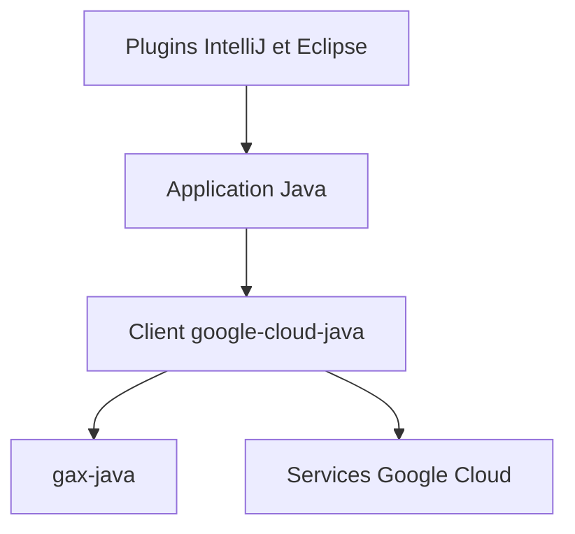

# googleapis/google-cloud-java

> Idiomatic Java client libraries for Google Cloud services, aimed at Java developers.

## The problem
Calling the Google Cloud APIs from Java by hand (REST, authentication) is slow and fragile.

## What it actually does
A set of Java clients, one per service (Storage, BigQuery, Datastore, etc. cited for App Engine). Semantic versioning, with `@BetaApi` and `@InternalApi` components and Stable or Preview levels.

## How it is wired
Simplified diagram based on the sheet, no diagram provided.



## Trying it
No command documented in the README: installation goes through the official guide.
```bash
# non documenté dans le README ; voir le guide Java on Google Cloud
```

## Cost and gotchas
A Google Cloud project and credentials are required; the services called are billed by Google. Beta components may break between minor versions.

## What it is not
Not a standalone tool. 0.x versions may change without compatibility. gax-java must not be used on its own.

## Alternatives
No alternative named in the README.

## For you
Adopt if you are on GCP with Java: official libraries, daily activity, Apache-2.0 license.
