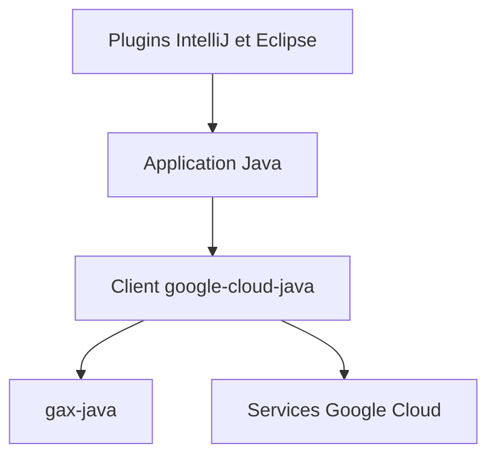

# googleapis/google-cloud-java

> Bibliothèques clientes Java idiomatiques pour les services Google Cloud, destinées aux développeurs Java.

## Le problème
Appeler les API Google Cloud en Java à la main (REST, authentification) est long et fragile.

## Ce que ça fait vraiment
Un ensemble de clients Java par service (Storage, BigQuery, Datastore, etc. cités pour App Engine). Versionnement sémantique, avec composants `@BetaApi`, `@InternalApi` et niveaux Stable ou Preview.

## Comment c'est branché
Schéma simplifié d'après la fiche, sans diagramme fourni.



## Essayer
Aucune commande documentée dans le README : l'installation passe par le guide officiel.
```bash
# non documenté dans le README ; voir le guide Java on Google Cloud
```

## Coût et pièges
Un projet Google Cloud et des identifiants sont nécessaires ; les services appelés sont facturés par Google. Les composants Beta peuvent casser entre versions mineures.

## Ce que ce n'est pas
Pas un outil autonome. Les versions 0.x peuvent changer sans compatibilité. gax-java ne doit pas s'utiliser seul.

## Alternatives
Aucune alternative nommée dans le README.

## Pour toi
À adopter si tu es sur GCP en Java : bibliothèques officielles, activité quotidienne, licence Apache-2.0.

