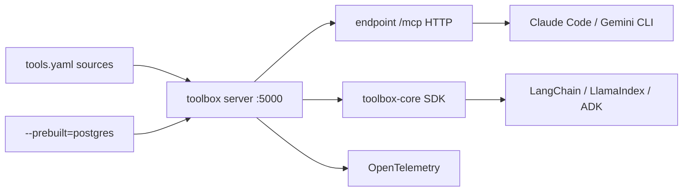

# googleapis/mcp-toolbox

> MCP server that connects an agent to databases, either generically or with custom tools.

## The problem
Giving an agent database access means either opening an all-purpose `execute_sql`, or hand-writing one tool per query, with auth and pooling.

## What it actually does
Dual use. At build time: `--prebuilt=postgres` instantly exposes generic tools (`list_tables`, `execute_sql`) to Gemini CLI, Claude Code, Codex, Antigravity.
At run time: a `tools.yaml` declares `sources` (connections), `tools` (typed parameterized query, with an SQL `statement` and `parameters`), `toolsets` (loadable groups), `prompts` and read-only `resources`/`resourceTemplates`.
Connection pooling, built-in IAM auth, OpenTelemetry traces. Databases covered: AlloyDB, BigQuery, Cloud SQL, Spanner, Firestore, PostgreSQL, MySQL, MariaDB, SQL Server, Oracle, MongoDB, Redis, Elasticsearch, CockroachDB, ClickHouse, Couchbase, Neo4j, Snowflake, Trino. Python, JS/TS and Go SDKs, with LangChain, LlamaIndex, Genkit, ADK adapters.

## How it is wired


## Trying it
```bash
npx @toolbox-sdk/server --prebuilt=postgres --stdio
npx @toolbox-sdk/server --config tools.yaml
brew install mcp-toolbox
go install github.com/googleapis/mcp-toolbox@v1.12.0
pip install toolbox-core
```

## Cost and gotchas
Apache 2.0, free server. The `genai-toolbox` repository was renamed `mcp-toolbox`: you need to update the remote. Dynamic reloading is on by default (`--disable-reload` to turn it off). The `source` example puts the password in clear text in the YAML. Google is simultaneously pushing a paid managed offering.

## What it is not
Not a database nor an ORM: an exposure layer. Prebuilt mode is not safe by default — it is the custom tools mode that brings restricted access and structured queries.

## Alternatives
- Google Cloud MCP Servers: the managed version, no self-hosting.
- Gemini CLI extensions: turnkey installation per database, but limited to Gemini.

## For you
The right way to give an agent scoped SQL access — the `tools.yaml` is worth a look even without Google Cloud.
