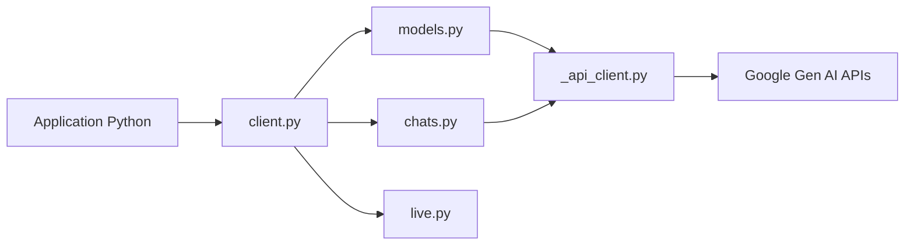

# googleapis/python-genai

> Google's official Python SDK for calling Gemini (Developer API or Enterprise platform) from an app.

## The problem
Calling Gemini models by hand (HTTP, auth, streaming, files, batch) is tedious and differs between the Developer API and the Enterprise platform (formerly Vertex AI).

## What it actually does
A single `Client` exposes `models` (generate_content, embeddings, Imagen images, Veo video, token counting), `chats`, `files`, `caches`, `batches`, `tunings`, `interactions` and `live`. Inputs accept Pydantic types or dicts; async mode goes through `client.aio`. Transport is httpx, with aiohttp optional. Automatic Python function calling and experimental MCP support are included.

## How it is wired


## Trying it
```bash
pip install google-genai
uv pip install google-genai
export GEMINI_API_KEY='your-api-key'
```
```python
from google import genai
client = genai.Client()
response = client.models.generate_content(
    model='gemini-flash-latest', contents='Why is the sky blue?'
)
print(response.text)
```

## Cost and gotchas
A Gemini key or Google Cloud project is required; calls are billed by Google. The README announces an upcoming major version that removes automatic function calling from `generate_content` and several `Live` methods: pin `< 3.0.0`.

## What it is not
Not an agent framework or a multi-provider client: it only talks to Google APIs. Some features (tunings, batch, upscale) only work on the Enterprise platform, others (files) only on the Developer API.

## Alternatives
- google-gemini/gemini-skills and google/skills: skills to load into a coding assistant so it writes up-to-date SDK code.

## For you
Adopt it as soon as you use Gemini in Python: it is the client maintained by Google, with 315 open issues but a recent push; watch the move to 3.0.
