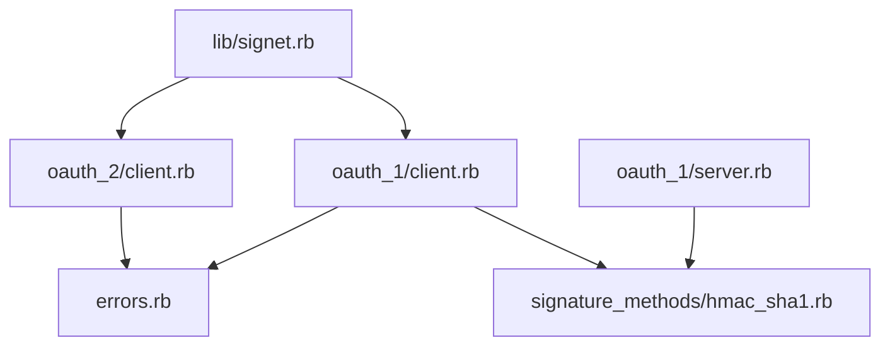

# googleapis/signet

> Ruby library implementing OAuth 1.0 and OAuth 2.0, for Ruby developers authenticating with Google.

## The problem
Signing requests and obtaining OAuth tokens by hand in Ruby is tedious and error-prone.

## What it actually does
Signet provides OAuth 1.0 clients and server, an OAuth 2.0 client, and the HMAC, RSA and plaintext signature methods. The README example configures a Google client with authorization URI, client_id, secret and scope, then exchanges the code for an access token.

## How it is wired
Diagram based on the code diagram.


## Trying it
```bash
gem install signet
```

## Cost and gotchas
Free. You need Ruby and, for Google, an OAuth client created in the Google console (account at your expense). The client secret must not be hard-coded.

## What it is not
Not a complete Google API library: it only handles the OAuth protocol. The README is brief and points to the reference.

## Alternatives
No alternative named in the README.

## For you
Ignore: a Ruby authentication building block, unrelated to a data, AI or MLOps profile.
