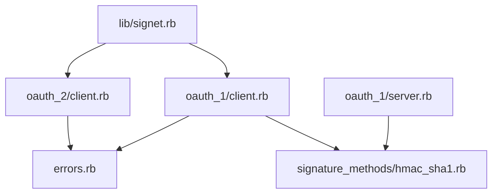

# googleapis/signet

> Bibliothèque Ruby implémentant OAuth 1.0 et OAuth 2.0, pour développeurs Ruby qui s'authentifient auprès de Google.

## Le problème
Signer des requêtes et obtenir des jetons OAuth à la main en Ruby est fastidieux et source d'erreurs.

## Ce que ça fait vraiment
Signet fournit des clients et un serveur OAuth 1.0, un client OAuth 2.0, et les méthodes de signature HMAC, RSA et plaintext. L'exemple du README configure un client Google avec URI d'autorisation, client_id, secret et scope, puis échange le code contre un jeton d'accès.

## Comment c'est branché
Schéma d'après le diagramme du code.


## Essayer
```bash
gem install signet
```

## Coût et pièges
Gratuit. Il faut Ruby et, pour Google, un client OAuth créé dans la console Google (compte à ta charge). Le secret client ne doit pas être codé en dur.

## Ce que ce n'est pas
Ce n'est pas une bibliothèque d'API Google complète : elle ne gère que le protocole OAuth. Le README est bref et renvoie à la référence.

## Alternatives
Aucune alternative nommée dans le README.

## Pour toi
À ignorer : brique Ruby d'authentification, sans lien avec un profil data, IA ou MLOps.

