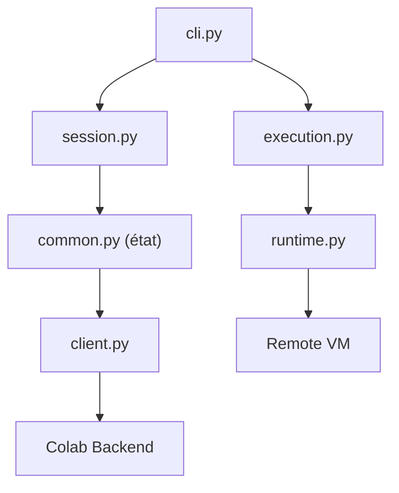

# googlecolab/google-colab-cli

> Command line to start CPU, GPU or TPU Colab machines and run code on them from the terminal.

## The problem
Using a Colab GPU forces you through the browser, which gets in the way of automation and agents.

## What it actually does
The colab command allocates a VM (CPU, T4, L4, G4, A100, H100 GPU, or TPU), runs Python, a notebook or code from standard input, transfers files and opens an SSH shell. colab run launches a script on an ephemeral VM and then releases it. It mounts Google Drive, installs packages with uv and exports history as .ipynb, .md or .jsonl. Linux and macOS only.

## How it is wired


## Trying it
```bash
uv tool install google-colab-cli
colab new
echo 'print("Hello from Google Colab!")' | colab exec
colab stop
colab run --gpu T4 train.py
```

## Cost and gotchas
You need a Google account; GPUs consume Colab compute units and --high-mem requires a Pro subscription. No Windows support: use WSL.

## What it is not
It is not a compute server of your own: everything depends on the Colab backend. Quotas and GPU availability remain those of Colab.

## Alternatives
No alternative named in the README (it points to the Colab MCP server for use inside the notebook).

## For you
Adopt: it lets you launch a short GPU training run from a script or an agent, with automatic VM cleanup.
