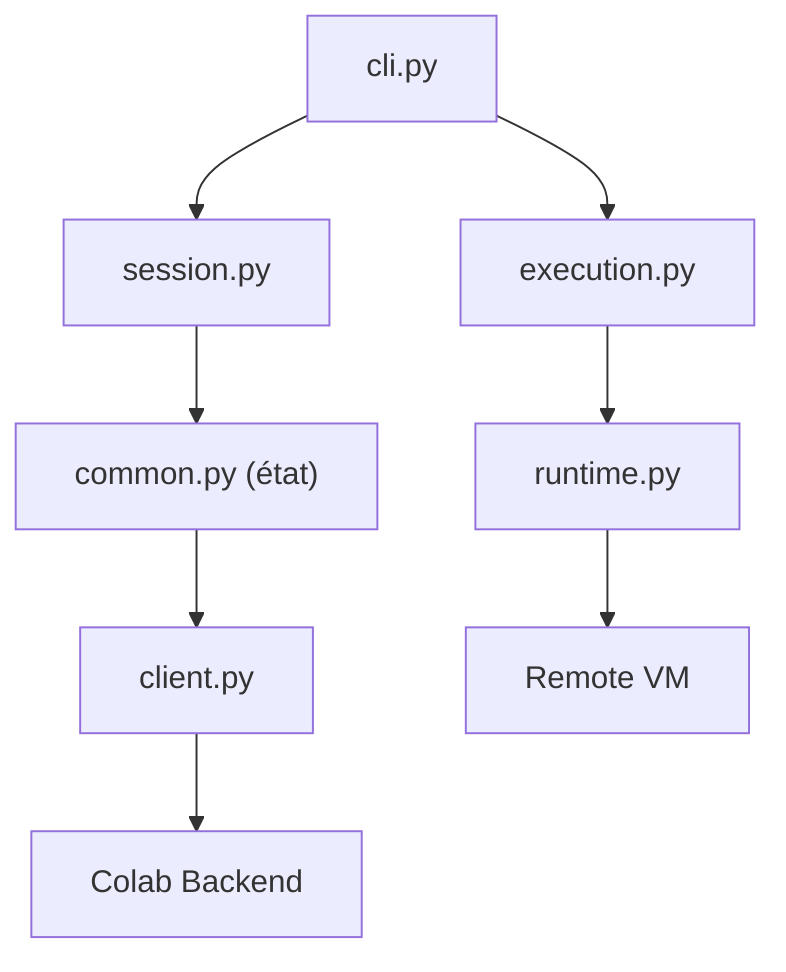

# googlecolab/google-colab-cli

> Ligne de commande pour lancer des machines Colab CPU, GPU ou TPU et y exécuter du code depuis le terminal.

## Le problème
Utiliser un GPU Colab oblige à passer par le navigateur, ce qui gêne l'automatisation et les agents.

## Ce que ça fait vraiment
La commande colab alloue une VM (CPU, GPU T4, L4, G4, A100, H100, ou TPU), exécute du Python, un notebook ou du code en entrée standard, transfère les fichiers et ouvre un shell SSH. colab run lance un script sur une VM éphémère puis la libère. Elle monte Google Drive, installe des paquets avec uv et exporte l'historique en .ipynb, .md ou .jsonl. Linux et macOS seulement.

## Comment c'est branché


## Essayer
```bash
uv tool install google-colab-cli
colab new
echo 'print("Hello from Google Colab!")' | colab exec
colab stop
colab run --gpu T4 train.py
```

## Coût et pièges
Il faut un compte Google ; les GPU consomment des unités de calcul Colab et --high-mem exige un abonnement Pro. Pas de support de Windows : passer par WSL.

## Ce que ce n'est pas
Ce n'est pas un serveur de calcul à toi : tout dépend du backend Colab. Les quotas et la disponibilité des GPU restent ceux de Colab.

## Alternatives
Aucune alternative nommée dans le README (il renvoie vers le serveur MCP Colab pour l'usage dans le notebook).

## Pour toi
À adopter : il permet de lancer un entraînement GPU court depuis un script ou un agent, avec nettoyage automatique de la VM.

