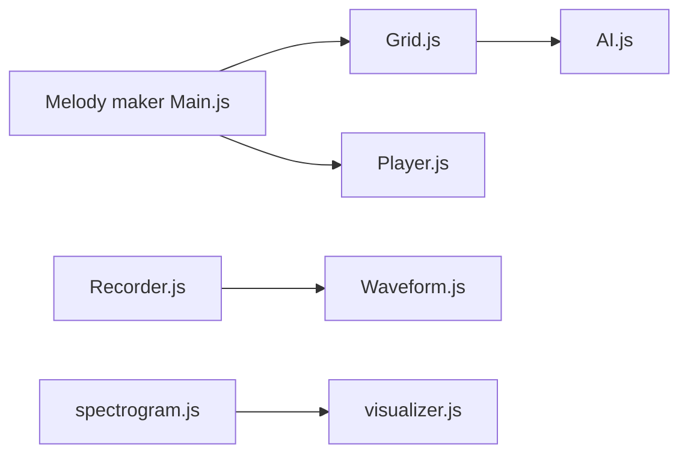

# googlecreativelab/chrome-music-lab

> Source code of Google's web music experiments, archived, useful as a Web Audio reference.

## The problem
Learning music or sound by hands-on manipulation, and having Web Audio code examples available.

## What it actually does
A collection of independent in-browser experiments: arpeggios, chords, a melody editor with grid AI, a piano roll, microphone recording and Soundspinner, a spectrogram with a 3D visualizer, strings and harmonics, sound waves. Technologies cited: Web Audio API, WebRTC, WebMIDI, Tone.js. Each folder has its own README.

## How it is wired


## Trying it
```bash
# Aucune commande dans ce README : voir le README de chaque dossier d'expérience.
```

## Cost and gotchas
Free. Repository archived, last push in February 2024, short README: you have to open each experiment to know how to build it.

## What it is not
Not a single application nor a reusable library: a collection of demos.

## Alternatives
No alternative named; Tone.js is cited as a building block used.

## For you
Ignore: an archive of web demos unrelated to your field, worth consulting only for Web Audio inspiration.
