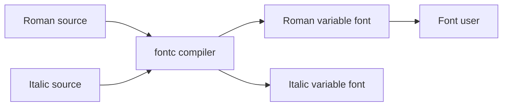

# googlefonts/googlesans-code

> Monospaced font family for code, in Roman and Italic variable fonts.

## The problem
Editors and terminals need a font where every character stays distinct even at small sizes.

## What it actually does
Provides the Glyphs sources and the compiled variable fonts (weight axis from 300 to 800), with OpenType stylistic sets and localized forms, for extended Latin. Built with `fontc` from the `.glyphspackage` packages; CI that builds and tests every push.

## How it is wired


## Trying it
```shell
git clone https://github.com/googlefonts/googlesans-code.git
fontc sources/GoogleSansCode.glyphspackage --flatten-components --decompose-transformed-components --output-file fonts/variable/GoogleSansCode[MONO,wght].ttf
```

## Cost and gotchas
Free, OFL-1.1 license. To build, use the `fontc` version given in `requirements.txt`.

## What it is not
Not a software tool: it is a font. Extended Latin only.

## Alternatives
No alternative named in the README.

## For you
Worth watching: one more code font to try in your editor, with no technical stakes; download the release rather than building it.
