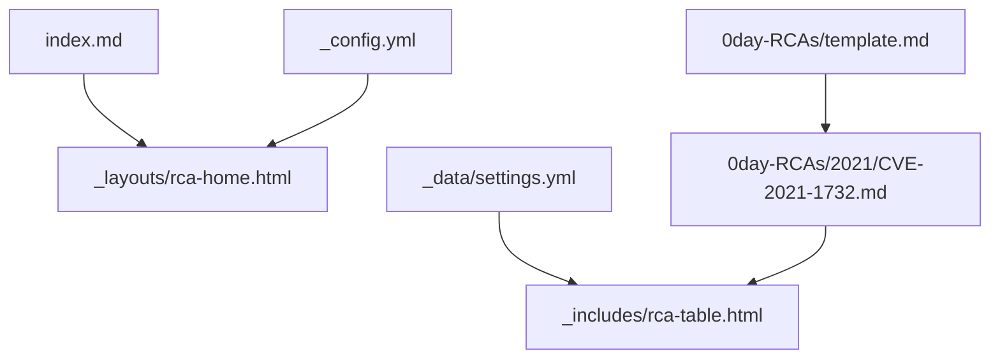

# googleprojectzero/0days-in-the-wild

> Reference of root-cause analyses of 0-day vulnerabilities exploited in the wild, for security researchers.

## The problem
Understanding how real 0-day vulnerabilities were exploited requires public analyses gathered in one place.

## What it actually does
Jekyll site: each root-cause analysis is a Markdown file per year in `0day-RCAs/`, written from `template.md`. A table tracks the vulnerabilities. The README points to the GitHub Pages site and states that this is not an official Google product.

## How it is wired

## Trying it
No documented command: visit googleprojectzero.github.io/0days-in-the-wild.

## Cost and gotchas
Free. Very short README. The content describes vulnerabilities; it contains no tool.

## What it is not
Not an attack tool or a scanner: analysis documentation.

## Alternatives
No alternative named in the README.

## For you
Worth watching: useful reading for an MLOps engineer's security culture, outside daily use.
