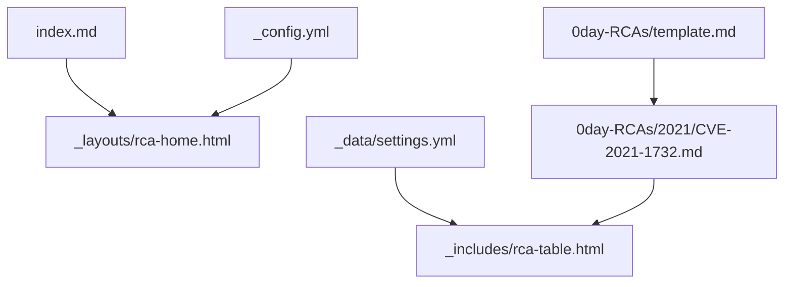

# googleprojectzero/0days-in-the-wild

> Référence d'analyses de cause racine de failles 0-day exploitées dans la nature, pour chercheurs en sécurité.

## Le problème
Comprendre comment des failles 0-day réelles ont été exploitées demande des analyses publiques regroupées.

## Ce que ça fait vraiment
Site Jekyll : chaque analyse de cause racine est un fichier Markdown par année dans `0day-RCAs/`, écrit d'après `template.md`. Une table suit les failles. Le README renvoie vers les GitHub Pages et précise que ce n'est pas un produit Google officiel.

## Comment c'est branché

## Essayer
Aucune commande documentée : consulter googleprojectzero.github.io/0days-in-the-wild.

## Coût et pièges
Gratuit. README très court. Le contenu décrit des failles, il ne contient pas d'outil.

## Ce que ce n'est pas
Pas un outil d'attaque ni un scanner : de la documentation d'analyse.

## Alternatives
Aucune alternative nommée dans le README.

## Pour toi
À surveiller : lecture utile pour la culture sécurité d'un MLOps, hors usage quotidien.

