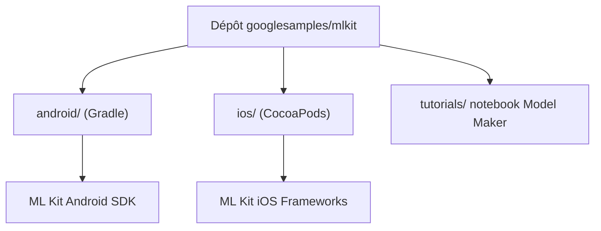

# googlesamples/mlkit

> Google's starter samples for the ML Kit APIs on Android and iOS, for mobile developers.

## The problem
Integrating an ML Kit API (barcodes, translation, digital ink) requires starting from a project that builds. Without a reference sample, you end up fumbling around.

## What it actually does
It is a repository of independent projects, not a tool that runs. Each folder (android/, ios/, tutorials/) is an isolated sample with its own Gradle or Xcode setup. A notebook shows how to train an image-labeling model with Model Maker. Pull requests are no longer accepted: Google fixes things internally and then syncs.

## How it is wired


## Trying it
```bash
# Aucune commande dans le README : cloner le dépôt,
# puis ouvrir un exemple dans Android Studio ou Xcode.
```

## Cost and gotchas
Free, but you need Android Studio or Xcode depending on the platform. Each sample is built separately.

## What it is not
It is not a library or a runtime: there is nothing to install. No sample is meant to be used in production as is. The README is very short; the detail comes from the diagram.

## Alternatives
No alternative named in the README.

## For you
Keep an eye on it: only useful if you are porting AI to mobile, otherwise it is outside your data / MLOps scope.
