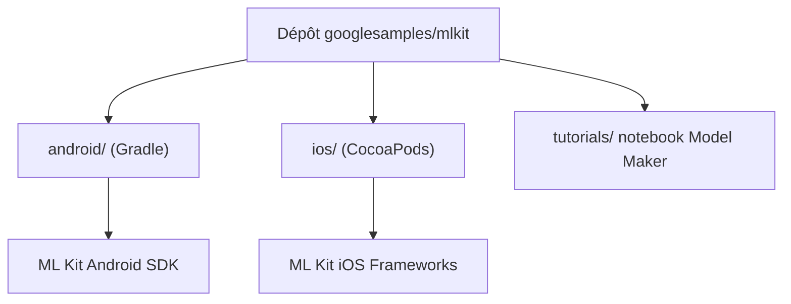

# googlesamples/mlkit

> Exemples de démarrage Google pour les API ML Kit sur Android et iOS, pour développeurs mobiles.

## Le problème
Intégrer une API ML Kit (code-barres, traduction, encre numérique) demande de partir d'un projet qui compile. Sans exemple de référence, on tâtonne.

## Ce que ça fait vraiment
C'est un dépôt de projets indépendants, pas un outil qui tourne. Chaque dossier (android/, ios/, tutorials/) est un exemple isolé avec son propre Gradle ou Xcode. Un notebook montre l'entraînement d'un modèle d'étiquetage d'images avec Model Maker. Les pull requests ne sont plus acceptées : Google corrige en interne puis synchronise.

## Comment c'est branché


## Essayer
```bash
# Aucune commande dans le README : cloner le dépôt,
# puis ouvrir un exemple dans Android Studio ou Xcode.
```

## Coût et pièges
Gratuit, mais il faut Android Studio ou Xcode selon la plateforme. Chaque exemple se construit séparément.

## Ce que ce n'est pas
Ce n'est pas une bibliothèque ni un runtime : rien à installer. Aucun exemple n'est pensé pour la production telle quelle. Le README est très court, le détail vient du diagramme.

## Alternatives
Aucune alternative nommée dans le README.

## Pour toi
Surveiller : utile seulement si tu portes de l'IA sur mobile, sinon c'est hors de ton périmètre data / MLOps.

