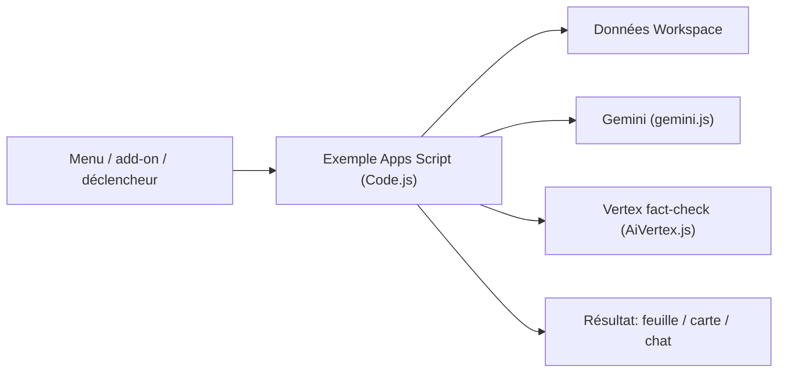

# googleworkspace/apps-script-samples

> Google Apps Script code samples to automate Docs, Sheets, Gmail, Drive, Calendar, with Gemini use cases.

## The problem
Automating Google Workspace (emails, spreadsheets, calendars) without starting from a blank page.

## What it actually does
A collection of samples organized by API: Admin SDK, Calendar, Classroom, Docs, Drive, Forms, Gmail, Sheets, Slides, Tasks, triggers. The graph shows families of examples: AI (sheet or file summaries, Gemini, Vertex fact-checking, Drive renaming), automations (mail merge, PDF, timesheets) and WebAssembly (image compression, Python function). It is not a single application.

## How it is wired


## Trying it
```bash
pnpm lint    # ESLint sur tout le dépôt, corrige les erreurs simples
pnpm check   # vérification TypeScript des fichiers .gs via JSDoc
# Clonage des projets : outil en ligne de commande clasp
```

## Cost and gotchas
Free, Google account required. The AI examples call Gemini/Vertex: possible quotas and billing on the Google Cloud side. Several implementations were not sampled: internal connections unknown.

## What it is not
Not a reusable library: these are examples to copy.

## Alternatives
None cited in the README.

## For you
Worth watching: a good starting point for light automations around Sheets and Gemini, with no infrastructure to manage.
