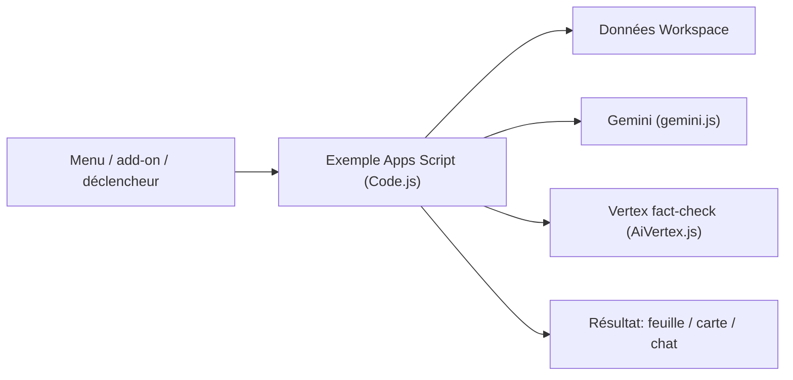

# googleworkspace/apps-script-samples

> Exemples de code Google Apps Script pour automatiser Docs, Sheets, Gmail, Drive, Calendar, avec des cas Gemini.

## Le problème
Automatiser Google Workspace (mails, feuilles, agendas) sans partir d'une page blanche.

## Ce que ça fait vraiment
Collection d'échantillons organisés par API : Admin SDK, Calendar, Classroom, Docs, Drive, Forms, Gmail, Sheets, Slides, Tasks, déclencheurs. Le graphe montre des familles d'exemples : IA (résumé de feuille ou de fichier, Gemini, vérification factuelle Vertex, renommage Drive), automatisations (publipostage, PDF, feuilles de temps) et WebAssembly (compression d'image, fonction Python). Ce n'est pas une application unique.

## Comment c'est branché


## Essayer
```bash
pnpm lint    # ESLint sur tout le dépôt, corrige les erreurs simples
pnpm check   # vérification TypeScript des fichiers .gs via JSDoc
# Clonage des projets : outil en ligne de commande clasp
```

## Coût et pièges
Gratuit, compte Google requis. Les exemples IA appellent Gemini/Vertex : quotas et facturation éventuels côté Google Cloud. Plusieurs implémentations non échantillonnées : connexions internes inconnues.

## Ce que ce n'est pas
Pas une bibliothèque réutilisable : ce sont des exemples à copier.

## Alternatives
Aucune citée dans le README.

## Pour toi
Surveiller : bon point de départ pour des automatisations légères autour de Sheets et Gemini, sans infrastructure à gérer.

