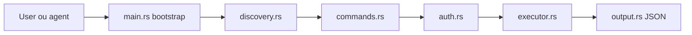

# googleworkspace/cli

> A single CLI for all Google Workspace APIs, with JSON output, for humans and AI agents.

## The problem
Calling Drive, Gmail, Calendar or Sheets means `curl` against the REST docs and repeated authentication code.

## What it actually does
`gws` reads Google's Discovery Service at runtime and builds its commands dynamically (24 h cache). JSON output, NDJSON pagination, `--dry-run`, `gws schema`. Helper commands prefixed with `+` (`gmail +send`, `calendar +agenda`, `workflow +standup-report`). Over 100 agent skills, a Gemini CLI extension, response sanitization via Model Armor. Encrypted credentials (AES-256-GCM).

## How it is wired


## Trying it
```bash
npm install -g @googleworkspace/cli
gws auth setup
gws auth login
gws drive files list --params '{"pageSize": 5}'
```

## Cost and gotchas
Free, but you need a Google Cloud project and OAuth credentials. In test mode, ~25 scopes max: the `recommended` preset fails, so choose the services (`-s drive,gmail`). Add your account as a test user. Breaking changes expected before v1.0.

## What it is not
Not an official Google product (the README says so twice). Works only with Google Workspace; the command surface depends on the Discovery Service.

## Alternatives
`gcloud` for authentication and the token (cited in the README).

## For you
Worth watching: very handy for giving an agent structured access to Gmail, Drive or Sheets, but the unofficial status and still-unstable API suggest waiting for v1.0.
