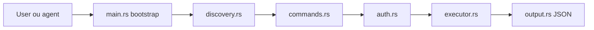

# googleworkspace/cli

> CLI unique pour toutes les API Google Workspace, à sortie JSON, pour humains et agents IA.

## Le problème
Appeler Drive, Gmail, Calendar ou Sheets suppose du `curl` contre la doc REST et du code d'authentification répété.

## Ce que ça fait vraiment
`gws` lit le Discovery Service de Google à l'exécution et construit ses commandes dynamiquement (cache 24 h). Sortie JSON, pagination NDJSON, `--dry-run`, `gws schema`. Commandes d'aide préfixées `+` (`gmail +send`, `calendar +agenda`, `workflow +standup-report`). Plus de 100 skills d'agent, extension Gemini CLI, nettoyage de réponses via Model Armor. Identifiants chiffrés (AES-256-GCM).

## Comment c'est branché


## Essayer
```bash
npm install -g @googleworkspace/cli
gws auth setup
gws auth login
gws drive files list --params '{"pageSize": 5}'
```

## Coût et pièges
Gratuit, mais il faut un projet Google Cloud et des identifiants OAuth. En mode test, ~25 scopes max : le préréglage `recommended` échoue, choisir les services (`-s drive,gmail`). Ajouter son compte en utilisateur de test. Changements cassants attendus avant la v1.0.

## Ce que ce n'est pas
Pas un produit officiel Google (le README le dit deux fois). Ne fonctionne qu'avec Google Workspace ; surface de commandes dépendante du Discovery Service.

## Alternatives
`gcloud` pour l'authentification et le jeton (cité dans le README).

## Pour toi
À surveiller : très pratique pour donner à un agent un accès structuré à Gmail, Drive ou Sheets, mais le statut non officiel et l'API encore instable invitent à attendre la v1.0.

